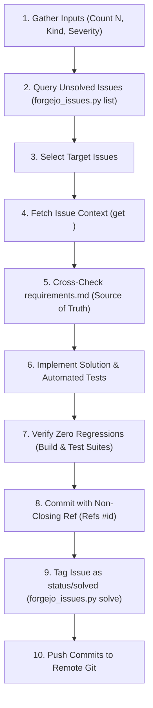

# Forgejo Issue Resolver Workflow

This skill provides an automated, end-to-end workflow to fetch open issues from a Forgejo or Gitea instance, triage them according to user-specified **kind** (`bug`, `performance`, `data-integrity`, `security`), **severity** (`low`, `medium`, `high`), and **count**, implement the necessary code and test changes, verify builds, and tag the issues on Forgejo with `status/solved` along with resolution comments.

> [!IMPORTANT]
> **REQUIREMENTS.MD IS THE LOGIC SOURCE OF TRUTH**: `requirements.md` in the repository root defines the expected application behavior. If a Forgejo issue, `README.md`, `AGENTS.md`, or the current code disagrees with `requirements.md`, **`requirements.md` wins**. Do NOT implement changes that violate `requirements.md` or alter items marked as `out of scope` or under **Open questions**. Always cite requirement IDs (e.g. `ACC-2`, `INV-1`, `SEC-7`) in commits and issue comments.
>
> **DO NOT CLOSE ISSUES**: This skill must **NOT** close issues. It must tag them with the label `status/solved` so maintainers can inspect and formally close them after review.
>
> **GIT COMMIT KEYWORDS**: Do **NOT** use closing keywords (`Closes #12`, `Fixes #12`, `Resolves #12`) in Git commits or push messages, as Forgejo's server-side hooks will automatically close the issue upon push. Instead, use non-closing references:
> `Refs #12 (status/solved)` or `Relates to #12`.



---

## 1. Input Parameters

When invoked, the agent must ensure the following parameters are specified:

1. **Target Count (`N` / `--limit`)**:
   - Number of issues to process in the current run (e.g., 1, 2, 5). Default to 1 if not specified.

2. **Issue Kind (`--kind`)**:
   - `bug`: Defects, runtime errors, crashes, broken UI interactions, or unhandled exceptions.
   - `performance`: Latency bottlenecks, query optimization, N+1 queries, memory leaks, slow exports/imports, CPU blocking tasks.
   - `data-integrity`: Accounting balance imbalances, rounding errors, precision loss, hierarchy cycles, cascade deletion risks, reconciliation state inconsistencies.
   - `security`: Authentication bypass, JWT flaws, plaintext leaks, authorization / cross-tenant isolation, rate limiting, timing attacks, input injection.
   - `all`: Any open issue regardless of kind.

3. **Issue Severity (`--severity`)**:
   - `high`: Critical data corruption, security exploits, server crashes, blockers (P0/P1).
   - `medium`: Incorrect calculations under specific edge cases, missing validation, performance degradation (P2).
   - `low`: Minor display inconsistencies, missing labels, code style/hardening, non-blocking optimizations (P3/P4).
   - `all`: Any severity level.

Issues already tagged with `status/solved` are automatically skipped during selection so repeated invocations advance to the next unsolved issue.

---

## 2. Server & Authentication Setup

The bundled script [`forgejo_issues.py`](./scripts/forgejo_issues.py) automatically resolves the server URL and repository from the current Git remote origin:
- **LAN Forgejo Default**: `http://192.168.2.2:3001`
- **Repository Detection**: Automatically parsed from `git remote get-url origin` (e.g. `ssh://git@192.168.2.2:2222/kishansl/gnucash-web.git` -> `kishansl/gnucash-web`).

### Authentication Token (PAT)
To attach labels and post comments via API, a Forgejo Personal Access Token with `issue` and `repository` permissions is required:
- Set via environment variable:
  ```bash
  export FORGEJO_TOKEN="your_personal_access_token_here"
  ```
- Or save in `~/.config/forgejo/token`:
  ```bash
  mkdir -p ~/.config/forgejo && echo "your_personal_access_token_here" > ~/.config/forgejo/token
  chmod 600 ~/.config/forgejo/token
  ```

---

## 3. Step-by-Step Execution Guide

### Step 1: List and Triage Open Unsolved Issues
Run the list command with the specified kind, severity, and limit (already solved issues are excluded by default):
```bash
python3 ~/.gemini/config/skills/forgejo-issue-resolver/scripts/forgejo_issues.py \
  list --kind <bug|performance|data-integrity|security|all> \
       --severity <low|medium|high|all> \
       --limit <N>
```
Output returns structured JSON with issue numbers, titles, detected kind, detected severity, labels, and description previews.

### Step 2: Fetch Context for Each Selected Issue
Inspect the full issue description, reproduction steps, and discussion:
```bash
python3 ~/.gemini/config/skills/forgejo-issue-resolver/scripts/forgejo_issues.py \
  get <issue_number>
```

### Step 3: Cross-Check `requirements.md` (Logic Source of Truth)
`requirements.md` in the repository root is the authoritative source of truth for expected application behavior:
1. **Identify Requirement IDs**: Match the defect to its stable requirement ID(s) (e.g., `SEC-7` for password verification, `ACC-2` for exact double-entry balance, `INV-1`..`INV-3` for investment money balances, `IMP-4` for transaction import validation).
2. **Precedence Rules**:
   - If `requirements.md` disagrees with an issue's request, the code, or existing docs, **`requirements.md` wins**.
   - If an issue asks for behavior that `requirements.md` designates as `out of scope` (e.g. `SCOPE-3`) or an accepted limitation (e.g. `INV-6`), do NOT build it. Note the requirement citation in the issue comment.
   - If an issue pertains to an item listed under **Open questions** (`Q1`–`Q5`), keep current behavior and consult the user before taking action.
3. **Scope Invariants**: Verify that implementing the fix satisfies the requirement without regressing other defined requirements.

### Step 4: Implement Code Changes by Issue Kind
- **For `security` issues**:
  - Enforce least privilege, constant-time comparisons (`subtle::ConstantTimeEq`), strict input length bounds, user-scoped tenant isolation (UUID v5), and ensure no secrets or plaintext credentials leak into logs.
- **For `data-integrity` issues**:
  - Enforce atomic database transactions, strict double-entry balance validation (`sum == Decimal::ZERO`), decimal scale checking (`scale <= 2`), recursive CTE hierarchy cycle guards, and child existence checks before deletion.
- **For `performance` issues**:
  - Offload CPU-heavy tasks (bcrypt, crypto, SQLite dumps) via `spawn_blocking`, add database indexes, optimize N+1 queries, use `WHERE EXISTS` instead of bloated joins, and batch bulk insertions.
- **For `bug` issues**:
  - Identify root cause in application logic or UI state handling, implement targeted bug fix, and ensure error conditions are properly propagated.

### Step 5: Write Tests & Verify Zero Regressions
Always add regression tests specifically asserting the fix and citing the requirement ID:
```bash
# Backend tests
cargo test -- --test-threads=1

# Frontend build & UI verification
npm run build
node scripts/test_ui.mjs
```

### Step 6: Git Commit with Non-Closing Reference
> [!WARNING]
> Do **NOT** use `Closes #N` or `Fixes #N` in commit messages. Use `Refs #N (status/solved)` and cite the requirement ID:

```bash
git add .
git commit -m "<type>(<scope>): <concise summary of fix>

- Detail item 1
- Detail item 2
- Conforms to requirement <REQ-ID>

Refs #<issue_number> (status/solved)"
```

### Step 7: Tag Issue with status/solved on Forgejo (DO NOT CLOSE)
Attach the `status/solved` label and post the verification summary using the `solve` command, explicitly including the Requirement ID:
```bash
python3 ~/.gemini/config/skills/forgejo-issue-resolver/scripts/forgejo_issues.py \
  solve <issue_number> \
  --comment "Status: Solved via commit $(git rev-parse --short HEAD).

Summary of resolution:
- Requirement: <REQ-ID>
- Kind: <bug|performance|data-integrity|security>
- Severity: <low|medium|high>
- Changes:
  * <detail 1>
  * <detail 2>

All automated regression and integration tests passed successfully.
Issue left open with 'status/solved' label for maintainer review."
```

### Step 8: Push Commits to Remote
Publish the verified commits:
```bash
git push origin $(git branch --show-current)
```

---

## 4. Helper Script Reference

The CLI script is located at [`scripts/forgejo_issues.py`](./scripts/forgejo_issues.py).

Available subcommands:
- `list [--kind bug|performance|data-integrity|security|all] [--severity low|medium|high|all] [--limit N] [--include-solved]`: List open issues (excludes `status/solved` by default).
- `get <issue_number>`: Retrieve full issue details and comment history.
- `comment <issue_number> "<comment_text>"`: Add a comment to an issue.
- `solve <issue_number> [--comment "<comment_text>"]`: **Attach `status/solved` label and optional comment (keeps issue open).**
- `close <issue_number> [--comment "<comment_text>"]`: Explicitly close issue (only when specifically requested).
