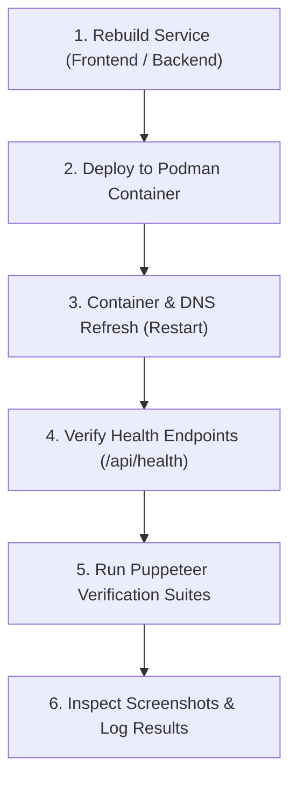

# GnuCash Web Deployment & Verification Workflow

This skill provides a standardized, repeatable procedure to compile, deploy to Podman containers, verify health endpoints, and execute Puppeteer automated UI verification suites with screenshot capture.



---

## 1. Fast Automation Script

Execute the bundled deployment script directly:

```bash
# Verify both stack and UI
./.agents/skills/gnucash-deploy-verify/scripts/deploy_and_test.sh all

# Or deploy frontend only and verify
./.agents/skills/gnucash-deploy-verify/scripts/deploy_and_test.sh frontend

# Or deploy backend only and verify
./.agents/skills/gnucash-deploy-verify/scripts/deploy_and_test.sh backend
```

---

## 2. Manual Step-by-Step Procedures

### A. Frontend Rebuild & Container Copy
```bash
cd frontend && npm run build
podman cp dist/. gnucash-frontend:/usr/share/nginx/html/
podman restart gnucash-frontend
```

### B. Backend Rebuild & Container Copy
```bash
cd backend && cargo build --release
podman cp ./target/x86_64-unknown-linux-gnu/release/gnucash-backend gnucash-backend:/app/gnucash-backend
podman restart gnucash-backend
# Nginx upstream DNS caches the backend container IP; restart frontend after backend
podman restart gnucash-frontend
```

### C. Health Check Verification
```bash
# Verify backend directly
curl -s http://localhost:8082/api/health
# Verify frontend Nginx proxy to backend
curl -s http://localhost:8081/api/health
```
Expected output:
```json
{"service":"gnucash-backend","status":"ok","version":"0.1.0"}
```

---

## 3. UI Verification Suites (Puppeteer)

Always run the automated Puppeteer suites to prevent regressions:

1. **General Navigation & User Dropdown**:
   ```bash
   cd frontend && node scripts/test_ui.mjs
   ```
   *Verifies desktop auth layout, user dropdown items (white font currency, export, import, seed, change password, reset), and mobile drawer.*

2. **Register Ledger & Autocomplete**:
   ```bash
   cd frontend && node scripts/test_register_autocomplete.mjs
   ```
   *Verifies complete historical payee autocomplete sourcing, dropdown display with occurrence counts, and full split autofill.*

3. **Full suite in an isolated environment** (includes every script that changes data):
   ```bash
   cd frontend && npm run test:e2e
   cd frontend && npm run test:e2e -- test_register_enhancements   # one suite
   ```
   *Runs against a throwaway `gnucash_e2e_test` database and backend, so live data is never modified. Scripts that change data refuse to run against the live app.*

---

## 4. Puppeteer React 18 Guidelines for New Tests

When writing or modifying Puppeteer scripts for React 18:
- Reset the controlled input value tracker before dispatching events:
  ```js
  const tracker = el._valueTracker;
  if (tracker) tracker.setValue('');
  Object.getOwnPropertyDescriptor(window.HTMLInputElement.prototype, 'value').set.call(el, val);
  el.dispatchEvent(new Event('input', { bubbles: true }));
  ```
- Always ensure dropdown trigger elements have both `onClick` and `onFocus` handlers.
- Credentials: `kishan` / `Kishan@123`.
