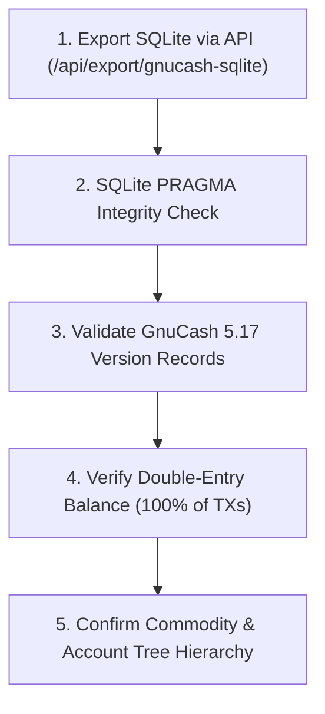

# GnuCash SQLite Database Inspection & Export Verification

This skill defines the schema constraints, validation rules, and automated testing tools for ensuring compatibility between GnuCash Web and desktop GnuCash 5.17+.



---

## 1. Quick Verification Command

Run the automated test script to export, inspect schema versions, and verify double-entry balance:

```bash
./.agents/skills/gnucash-sqlite-sync/scripts/verify_export.sh
```

---

## 2. GnuCash 5.17+ Versions Table Specification

To prevent desktop GnuCash from displaying *"The database is from an older version of GnuCash. Select OK to upgrade it to the current version"*, the SQLite `versions` table must populate the exact table versions expected by GnuCash 5.17:

| Table Name | Version | Purpose |
| :--- | :--- | :--- |
| `Gnucash` | `5000017` | Major version 5, minor version 17 encoding |
| `Gnucash-Resave` | `19920` | Desktop GnuCash resave build signature |
| `transactions` | `4` | Split transaction schema |
| `splits` | `5` | Double-entry journal splits |
| `accounts` | `1` | Account hierarchy & commodity mapping |
| `commodities` | `1` | Currencies and stocks table |
| `books` | `1` | Top-level ledger book |

---

## 3. SQLite Validation Queries

When troubleshooting an exported `.gnucash` database directly with Python or `sqlite3`:

### Check PRAGMA Integrity
```sql
PRAGMA integrity_check;
```

### Check Zero-Imbalance Enforcement
Every transaction in the `splits` table must balance to 0:
```sql
SELECT tx_guid, ROUND(SUM(value_num * 1.0 / value_denom), 4) as balance
FROM splits
GROUP BY tx_guid
HAVING ABS(balance) > 0.0001;
```
*(Expected: 0 rows)*

### Check Version Numbers
```sql
SELECT table_name, table_version FROM versions ORDER BY table_name;
```

### Check Top-Level Books & Root Account
```sql
SELECT b.guid, b.root_account_guid, a.name
FROM books b
JOIN accounts a ON b.root_account_guid = a.guid;
```
